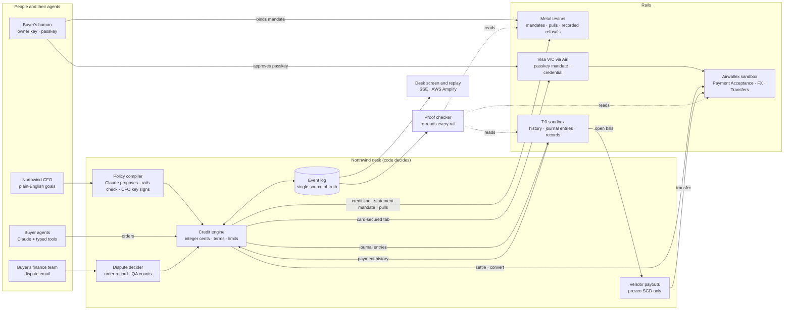
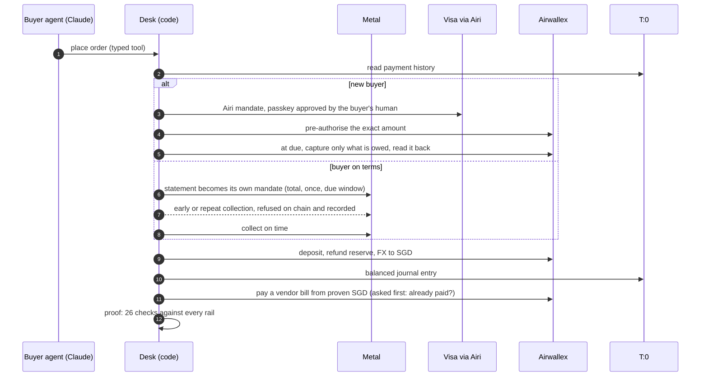

<p align="center"></p>

<h1 align="center">TAB: net terms for AI agents</h1>

<p align="center"><b>Every other agent-payments project teaches agents to hear "no". TAB says "yes, pay later", and still gets paid.</b></p>

<p align="center">
  <a href="https://youtu.be/_LsjxwVXuac"></a>
  <a href="https://main.d1k1s0hwodmj8i.amplifyapp.com"></a>
  <a href="proofs/demo-run.md"></a>
  
  
  <a href="LICENSE"></a>
</p>

Airwallex Agentic Banking Hackathon entry, team **Four Eyes, One Human**. Built on **Metal**, **Visa Intelligent Commerce via Airi**, **Airwallex** and **T:0**, with **Claude** reading the unstructured text.

## For judges: start here

| | Link |
| --- | --- |
| **Demo video** (4:50, one live run end to end) | **https://youtu.be/_LsjxwVXuac** |
| **Live project** (the desk screen replaying the live run; no login, no keys) | **https://main.d1k1s0hwodmj8i.amplifyapp.com** |
| **Proof of the run**: every id, every check, re-read after the run | [`proofs/demo-run.md`](proofs/demo-run.md) |
| **Metal**: statement collected through its own mandate | [`0x747b21ed…2baa`](https://testnet.metalntwx.com/tx/0x747b21ed394e3ec6f9de96f7f2e31e9187fa2829b76cfe780a60a13373ae2baa) |
| **Metal**: early collection refused, refusal recorded on chain | [`0x24ce402a…5c0b`](https://testnet.metalntwx.com/tx/0x24ce402afb5119a292f8c8d31095650cb43efee5ffa20abaa718d2408e665c0b) |
| **Metal**: second collection (fresh payment id) refused on chain | [`0x846e31d8…65fa`](https://testnet.metalntwx.com/tx/0x846e31d8684c0e528acd29253be9db1558166471c0bb0df632067b744e8a65fa) |
| **Visa via Airi + Airwallex**: passkey-approved hold, $48.00 captured of $60.00 | Airi mandate `mdt_sgpdtm62gho1x9c3g3c` · payment intent `int_sgpvfdzq7ho1x9bqqdg` |
| **Airwallex**: vendor bill paid by transfer from proven SGD | `P261111-ENB0OZO` (SGD 193.30 → USD 150.00, PAID) |
| **T:0**: balanced journal entries for every collection and the payout | JE-13 · JE-14 · JE-15 · JE-16 |
| Jump to a moment in the video | [Visa-secured tab 1:44](https://youtu.be/_LsjxwVXuac?t=104) · [Metal statement mandate 2:52](https://youtu.be/_LsjxwVXuac?t=172) · [Airwallex vendor payout 3:30](https://youtu.be/_LsjxwVXuac?t=210) · [26/26 proof 3:50](https://youtu.be/_LsjxwVXuac?t=230) · [attacks 3:58](https://youtu.be/_LsjxwVXuac?t=238) |
| Source and how to run it | this repo · [Run it locally](#run-it-locally) |

## The problem, and what TAB does

Businesses buy from each other on credit: ship today, pay in 30 days, 2% off for paying in 10. When the buyer is an AI agent, a supplier has no safe way to extend that credit, so agents are stuck paying upfront by card, every time.

TAB is the supplier's **credit desk for agent buyers**. **Northwind Data**, a B2B data supplier, sells to three buyer agents (Acme, Globex, Initech) on terms. TAB:

1. **decides** who gets terms (prepay, a card-secured tab, net-7, net-30) from payment history and verified payments,
2. **secures** them: a Metal debit mandate the buyer's human binds, or a passkey-approved Visa card hold,
3. **collects** on time, through the mandate, never more and never twice,
4. **settles** the money into Airwallex and converts it to SGD, then pays Northwind's own bills only from that proven money,
5. **proves** every dollar against every rail at the end.

Claude reads what humans write (the CFO's goals, a dispute email) and runs the buyer agents. **Code and the chain decide every dollar.**

## How TAB meets the judging criteria

Airwallex's builder guide asks for an agent built around a financial decision. Here is where each ask lives, in the code and in the run.

| The guide asks for | In TAB | Where |
| --- | --- | --- |
| A financial decision that **changes when balance, deadline, evidence or risk changes** | Terms and limits are recomputed on every event: a buyer's on-chain balance caps its limit; a verified Visa capture lifts Globex from prepay to net-7; an overdue T:0 invoice drops Initech to prepay; a buyer's human cutting the mandate makes the desk collect at once; the CFO's mid-book cap collects the excess | `src/domain/credit.ts`, `src/desk/desk.ts` · video 1:04–3:11 |
| **Goal → plan → new information → revised decision → resulting payment** | The CFO's goals become a signed policy; agents shop; new evidence arrives (a QA credit, a dispute, a cap, a cut line); the desk re-decides and the money moves on Metal, Visa and Airwallex | Scenes 1–8b in [`proofs/demo-run.md`](proofs/demo-run.md) |
| **Amounts, limits and state in code; the model for unstructured text** | Integer cents everywhere; Claude only compiles goals, reads emails and shops through typed tools. Every price, limit, credit and refusal comes from code; a proposal outside hard rails is rejected, never clamped | `src/domain/money.ts`, `src/policy/policy.ts`, `src/disputes/decide.ts` |
| **Typed tools, not raw credentials** | Buyer agents get four typed tools (`get_catalog`, `get_account`, `get_offer`, `place_order`); they never see a key, a card or a mandate | `src/agents/buyer.ts` |
| **Approvals bound to amount, currency, counterparty, terms and evidence** | A Metal statement mandate is bound to the exact total, one payment, the supplier as payee and a due window; the Visa hold is approved by passkey for the exact amount, and the payment carries the statement's hash; the CFO's policy is signed over its numbers and audit trail | `src/desk/desk.ts`, `src/visa/card-statement.ts`, `src/policy/policy.ts` |
| **Finish with a financial action, or an escalation** | Collections on Metal, captures on Airwallex, conversions to SGD, a vendor transfer, T:0 journal entries; anything code cannot decide (a refund request, a bill over the limit) goes to a person | `src/payout/vendor.ts`, `src/disputes/decide.ts` |
| **Proof** | 26 checks across the desk, Metal, Airwallex and T:0, run against the live rails after the run; 139 tests that run with no keys | `src/proof/checker.ts`, `test/` |

## How each sponsor's tool is used

### Metal: credit the chain enforces (Metal Award: Metal + Airwallex)

- **The credit line is a debit mandate.** Northwind issues a mandate credential; the buyer's human binds it with their owner key, naming Northwind as payee. The desk can never lend beyond it: limit = min(terms cap, mandate headroom, on-chain balance).
- **The statement is its own mandate.** When a tab comes due, the statement becomes a fresh mandate: cap and budget equal the statement total, one payment, a due window. The buyer's human binding it *is* the acceptance. The chain then refuses an early collection (`mandate_outside_recurrence`) and any second collection (`mandate_budget_spent`), and **Northwind records each refusal on chain**, so a seller can prove what it tried and what the buyer agreed to.
- **Line cuts are honoured at once.** When the buyer's human replaces the mandate with a lower budget, the desk collects the whole tab before the line is gone.
- **Crash safety.** A pull is recorded as in flight before it is sent; a restarted desk finds the transfer on chain (exact amount, buyer, payee) instead of sending it again.
- **With Airwallex:** every Metal collection settles into Airwallex (deposit, refund reserve, FX to SGD) and is booked in T:0.
- Code: `src/metal/agent.ts`, `src/desk/desk.ts` · Proof: [`proofs/metal-supplier-pull.md`](proofs/metal-supplier-pull.md), scenes 5b–8 of [`proofs/demo-run.md`](proofs/demo-run.md).

### Visa Intelligent Commerce via Airi: a stranger becomes a customer (Visa Award: VIC + Airwallex)

- **New buyers get a card-secured tab.** Globex has no history, so instead of prepay it gets a 7-day tab secured by a **passkey-approved Airi mandate** (a VIC credential). Airwallex Payment Acceptance **pre-authorises** the exact amount; nothing is taken.
- **Capture only what is owed.** Before the due date Northwind's own QA issues a $12 credit; at due the desk computes and captures **$48.00 of the $60.00 authorised**, and the rest of the hold lapses. The capture is read back from Airwallex before it counts.
- **The verified payment earns credit.** That capture is Globex's first record with Northwind and earns it net-7; net-30 needs three invoices paid on time. No buyer gets Metal terms before a Visa-verified payment.
- **Never split orders** to dodge the $200 per-transaction card cap; the authorisation result is reported back to Airi (`airi-cli mandate result`).
- Code: `src/visa/card-statement.ts`, `src/airi/cli.ts` · Proof: [`proofs/vic-statement.md`](proofs/vic-statement.md), scenes 3–3d.

### Airwallex: read back, convert, pay out

| Product | How TAB uses it |
| --- | --- |
| Payment Acceptance | Create, confirm (pre-auth), partial capture of a VIC credential; every card payment is **read back** before it counts |
| Global Accounts | USD deposit referencing each Metal collection (a sandbox simulation; the sandbox cannot receive stablecoins) |
| FX | Quote and conversion USD → SGD after keeping a refund reserve: SGD 351.68 in the run |
| Transfers | Pays Northwind's own T:0 vendor bill, funded in SGD, paid in USD, **only from proven money**; the request id names the bill, and Airwallex is asked first whether it already paid it |

Code: `src/airwallex/client.ts`, `src/settlement/bridge.ts`, `src/payout/vendor.ts` · Proof: [`proofs/airwallex-settlement.md`](proofs/airwallex-settlement.md).

### T:0: the books, in and out

- **History in:** every buyer's invoices are read from the T:0 sandbox and decide net-30, net-7 or prepay.
- **Entries out:** every collection is posted as a balanced journal entry (debit Airwallex cash, credit A/R naming the customer); the vendor payout debits A/P and credits cash.
- **Records:** Initech's history, Globex and the Slack bills were written into the sandbox through a custom API connection (labelled below).
- Code: `src/books/books.ts`, `src/books/desk-books.ts`, `src/books/t0records.ts`.

### Claude: reads and proposes, never decides money

`claude-opus-5-5` does three jobs: the **CFO policy compiler** (plain-English goals → typed changes, each citing the CFO's words; anything not expressible is flagged, never guessed), the **buyer agents** (shop and choose how to pay through typed tools, under their own company's limits in code) and the **dispute reader** (email → claims, which code decides from the order record).

## Architecture



A tab from order to proof:



## The live run (`rmwbpgwbj`, 11 Nov 2026)

`LIVE_VIC=1 npx tsx scripts/demo-run.ts` plays the story against the live rails; `npm run screen` shows it as it happens. The [live project](https://main.d1k1s0hwodmj8i.amplifyapp.com) and the video are recordings of this run; nothing in them is staged data. Full ids and after-run re-checks: [`proofs/demo-run.md`](proofs/demo-run.md).

1. **Acme earns terms.** Its earlier Visa payment is re-read from Airwallex; T:0 shows 3/3 invoices paid on time → net-30; its human binds a $400 line on Metal (its limit is capped by its testnet balance, $328.06).
2. **The CFO types goals.** "Offer 3% off for paying within 10 days… no single buyer above $350… give our best customers net-90." Claude compiles two changes and flags net-90 as not expressible; code checks every change against hard rails and dry-runs each buyer. The CFO's key (separate from the key that issues Metal credentials) signs the policy and its audit trail; the desk verifies the signature when it applies the policy and every time it loads it (a copy edited after signing is refused).
3. **Acme's agent shops** and takes the 3% discount on three orders ($218.25), because 3% for 20 days early is about 56% a year against its 12% cost of capital.
4. **Globex is new: no invoices with Northwind.** Its agent puts $60 on a 7-day tab secured by a Visa authorisation (passkey approved). Delivery QA flags one batch stale: a $12 credit note. At due, **$48 is captured of the $60 authorised**. That verified payment earns Globex net-7, and its agent buys 2,000 queries for $80.00 on net-7.
5. **Initech** is 24 days overdue in T:0 → prepay only; orders for terms it is not offered (net-30, or a card payment over the $200 cap) are refused by code.
6. **Dispute before money moves.** Claude reads the complaint; code declines claims with the order record, credits only the units Northwind's own QA flagged, at the price Acme was charged (200 × 3.88¢ = $7.76), and sends what it cannot decide to a person.
7. **Mid-book, the CFO tightens.** "No single buyer may owe us more than $100 … until month end." Claude caps both limits and flags "until month end" as not expressible. The dry run shows "would collect $116.40 now"; once the signed policy is applied, the desk collects exactly that on chain (whole orders, oldest first).
8. **The statement is the mandate.** Acme's remaining $94.09 is its own Metal mandate: early collection refused on chain, the on-time one pays, a replay under a fresh payment id refused on chain.
9. **Globex's human cuts its line**; the desk collects the $80.00 tab at once.
10. **Settle and book.** All three collections go into Airwallex and convert to SGD 351.68; each is posted to T:0 as a balanced journal entry naming its customer.
11. **Pay the vendor, once, from proven money.** Northwind reads its open bills from T:0 and asks Airwallex first which are already paid. An old $100 Slack bill T:0 still shows open was paid on Nov 10: refused. The oldest $150 bill is paid by Airwallex transfer (SGD 193.30) and booked; the next two wait because proven money no longer covers them; four large bills go to a person.
12. **Every dollar proven: 26/26.** Per buyer, charged − credits = collected + open − credit owed; no order collected twice; one transaction per payment id; card captures = owed after credits; each bill paid once from proven money; and live: every Metal transfer log moved exactly its amount from the buyer to Northwind, every refusal was sent by Northwind, every conversion SETTLED, the transfer reads back PAID for exactly the bill, every T:0 entry balances and equals what was collected or paid.

### Live ids

| Rail | What | Id |
| --- | --- | --- |
| Metal | Acme's statement, collected through its own mandate ($94.09) | [`0x747b21ed…2baa`](https://testnet.metalntwx.com/tx/0x747b21ed394e3ec6f9de96f7f2e31e9187fa2829b76cfe780a60a13373ae2baa) |
| Metal | Early collection refused, refusal recorded on chain | [`0x24ce402a…5c0b`](https://testnet.metalntwx.com/tx/0x24ce402afb5119a292f8c8d31095650cb43efee5ffa20abaa718d2408e665c0b) |
| Metal | Second collection under a fresh payment id refused, recorded on chain | [`0x846e31d8…65fa`](https://testnet.metalntwx.com/tx/0x846e31d8684c0e528acd29253be9db1558166471c0bb0df632067b744e8a65fa) |
| Metal | Mid-book collection after the CFO's $100 cap ($116.40) | [`0x5127fa60…6f1b`](https://testnet.metalntwx.com/tx/0x5127fa6000029348490fbde49fe87f6b252e23d6475ebf5ffd3c6d79d2056f1b) |
| Metal | Globex's tab collected after its line cut ($80.00) | [`0x2e47f617…508f`](https://testnet.metalntwx.com/tx/0x2e47f617c7036e278cc0595d2698727d69254d3951b0a6ddad31664f966b508f) |
| Visa via Airi + Airwallex | Card hold $60.00, captured $48.00 | Airi mandate `mdt_sgpdtm62gho1x9c3g3c` · payment intent `int_sgpvfdzq7ho1x9bqqdg` |
| Airwallex | Conversions USD → SGD (all SETTLED) | `34cc070a-cabb-42f0-96e3-88abf4953322` · `5a9efcad-2dd0-4974-895e-e6c63cd57518` · `55583dd4-947b-4531-bb4c-201906ca6c9e` |
| T:0 | Journal entries tied to the Metal collections (Acme ×2, Globex) | `je_prod_WBugsBqw5Aq3PBwi` (JE-13) · `je_prod_hFimq5sW8kYJSu2g` (JE-14) · `je_prod_ZUiXyDku3YpQeDy9` (JE-15) |
| Airwallex | **Transfer** paying T:0 vendor bill SLK-20261020 (USD 150.00), funded with SGD 193.30 of proven money; PAID | `65031918-a4f0-41ca-8476-bb1442944927` (P261111-ENB0OZO) |
| T:0 | That payment, booked: debit A/P - Vendors (Slack), credit Airwallex cash | `je_prod_oQ2H69SSLOFVYa5P` (JE-16) |
| Airwallex | An older Slack bill ($100) that T:0 still shows open, refused because Airwallex already paid it on Nov 10 | `e75afb28-5ef0-4bd6-a088-8907e6ef17f8` (P261110-20KVBW6) |
| Metal | Crash-mid-pull fault (on a copy of the previous run): the one $20.00 pull, not repeated | [`0xb6a6361f…a355`](https://testnet.metalntwx.com/tx/0xb6a6361fa19d0f6a32e64e145526bd866d3d946b36ad9cc6779ae5e19f03a355) |

Records we wrote into the T:0 sandbox before the run (`scripts/t0-seed-buyers.ts`, with a key issued for a custom API connection):

| What | Id |
| --- | --- |
| Initech: customer, a $60 invoice paid 5 days late (with its payment), a $400 invoice overdue since Oct 18 | customer `t0_customer_prod_32b95cfd29087b54e366`, invoices `t0_invoice_prod_204e2c557826fe478c4e`, `t0_invoice_prod_c421d82ed9d1b494d4f5` |
| Globex: customer, and the $80 it paid in the previous run (`rmwavgb3a`, Metal tx `0xd073…3d21`) as a payment applied to no invoice, so Globex has a T:0 id and no invoice history | customer `t0_customer_prod_abf65f998a5001ff9369`, payment `t0_cust_pmt_prod_90f23ed42e9848825e1b` |
| Three open $150 Slack bills a week apart, owed to our own Slack vendor record | vendor `t0_vendor_prod_1304a031646fcba3d7f4`; bills SLK-20261020, SLK-20261027, SLK-20261103 |
| A bill payment for the $100 Slack bill paid on Nov 10. T:0 accepted it, but that bill came in through another connection (Ramp) and our link to it did not resolve, so T:0 still shows it open; the desk asks Airwallex instead | our id `tab-billpay-t0_bill_prod_9a32a0da12fe3faf33e5` |

### Try to make TAB double-charge

Start the screen with `ALLOW_FAULTS=1` (localhost only) and press the buttons: re-send the paid statement (the desk answers from its own record and sends nothing), re-collect it under a fresh payment id, or collect $1 more (both go to Metal testnet, where the statement's mandate refuses them), **pay the vendor bill again** (the desk's lock refuses it, and Airwallex answers with the original transfer), or **kill the desk mid-pull on the credit line** (the restarted desk takes the payment from the chain instead of sending it again). The buyer's balance is read before and after, and the proof re-runs.

## Engineering details

- **Money is integer cents** inside the domain (`src/domain/money.ts`); conversion to major units happens only at the Metal and Airwallex edges. No floats decide money.
- **One event log is the source of truth.** Every decision, refusal and settlement is an event; the screen, the replay and the proof all read the same log.
- **Idempotency by design.** Every external call carries an id that names what it pays: Metal payment ids per statement, Airwallex request ids per conversion and per bill (`tab-bill-<bill id>`), T:0 journal entries keyed on the Metal tx or transfer id (a repeat returns the entry it made). Retries and later runs ask for the same id, so nothing is paid or booked twice.
- **Never pay twice, across runs.** Before deciding, the payout asks Airwallex which open bills it already paid, by request id or by bill number, amount and payee, so a bill the books still show open is refused, and its money is not set aside again.
- **Crash safety.** An in-flight pull is recorded (with the mandate's spent total) before it is sent; on restart the desk resolves it from the chain before deciding anything else.
- **The model proposes, rails decide.** Policy changes outside hard rails are rejected (never clamped); the CFO's policy is signed with a key separate from the Metal issuer key and verified on apply and on every load.
- **Verify, then count.** Card payments are read back from Airwallex, Metal transfers from their logs, conversions by status, journal entries by balance, before any of them counts toward terms or the proof.
- **Secrets stay out.** Keys live in `.env` and `keys/` (both git-ignored); the VIC credential file must be mode 0600; fault buttons work only on localhost with `ALLOW_FAULTS=1`; the public replay has no keys and calls no API.
- **Tests:** 139 tests across 18 files (credit engine, offers, desk, statements, card capture, money guards, faults, payouts, T:0 books and records, proof checker). They run with no keys.

## Run it locally

### 1. Just look (no keys, any OS)

Open the [live project](https://main.d1k1s0hwodmj8i.amplifyapp.com), or open `docs/index.html` from this repo in any browser. It is one self-contained file: the desk screen with run `rmwbpgwbj` inlined, a guided tour, the guarantees, the proof and every id.

### 2. Install and run the tests (no keys)

You need **Node.js 22.13 or newer** and **git**.

| OS | Install Node |
| --- | --- |
| macOS | `brew install node` (or [nodejs.org](https://nodejs.org)) |
| Linux | your package manager, or [nvm](https://github.com/nvm-sh/nvm): `nvm install 22` |
| Windows | `winget install OpenJS.NodeJS.LTS` (or [nodejs.org](https://nodejs.org)) |

Then, in a terminal (macOS/Linux) or PowerShell (Windows):

```bash
git clone https://github.com/TusharTechs/tab-net-terms.git
```

```bash
cd tab-net-terms
```

```bash
npm install
```

```bash
npm test
```

```bash
npm run typecheck
```

### 3. Run the live demo (sandbox keys)

The live run needs accounts on the rails: an Airwallex sandbox (with Payment Acceptance native API), a Metal testnet RPC URL, two T:0 sandbox keys (one that reads and posts journal entries, one issued for a custom API connection that writes records), an Airi CLI login with a test card, and a Claude API key.

On **macOS or Linux** (on **Windows, use WSL2** for this step: the Metal CLI is called through its POSIX shim and the VIC credential file must be mode 0600):

```bash
cp .env.example .env
```

Fill in `.env`, then create the CFO's policy-signing key, write the demo buyers' books into T:0, and sign in to Airi:

```bash
npx tsx scripts/create-policy-key.ts
```

```bash
npx tsx scripts/t0-seed-buyers.ts
```

```bash
npx airi-cli auth login
```

Run the story (the Visa step asks for a passkey approval), and watch it on the desk screen at http://localhost:4173:

```bash
LIVE_VIC=1 npx tsx scripts/demo-run.ts
```

```bash
npm run screen
```

```bash
ALLOW_FAULTS=1 npm run screen
```

Rebuild the replay page from a run:

```bash
npm run replay
```

Smaller tools: `scripts/try-cfo-policy.ts` (compile goals, no money moves), `scripts/try-buyer-agents.ts`, `scripts/try-dispute.ts`, `scripts/pay-vendor.ts`, `scripts/vic-statement.ts`, `scripts/settle-metal.ts`, `scripts/top-up-buyer.ts`.

## Project structure

```
tab-net-terms/
├── src/
│   ├── domain/        credit.ts (terms, limits, collect/escalate) · money.ts (integer cents)
│   ├── terms/         offers.ts: catalogue and payment options (card, card-secured tab, net-7, net-30, early-pay discount)
│   ├── desk/          desk.ts: the supplier desk (orders, statements, card tabs, credits, policy, payouts) · northwind.ts: demo identities
│   ├── policy/        policy.ts: CFO goals → Claude proposal → hard rails → signed policy
│   ├── agents/        buyer.ts: Claude buyer agents with typed tools and their company's limits in code
│   ├── disputes/      reader.ts (Claude: email → claims) · decide.ts (code: credits from the order record)
│   ├── metal/         agent.ts: metal-agent wrapper (credentials, binds, pulls, recorded refusals, transfer lookup)
│   ├── visa/          card-statement.ts: authorise at issue, capture the undisputed amount
│   ├── airi/          cli.ts: Airi CLI wrapper (passkey mandates, VIC credentials, results)
│   ├── airwallex/     client.ts: typed Airwallex client
│   ├── settlement/    bridge.ts: deposit → refund reserve → FX quote → conversion (idempotent)
│   ├── ledger/        settlements.ts: the desk's own double-credit guard
│   ├── payout/        vendor.ts: decide, pay once from proven SGD, book, record against the bill
│   ├── books/         books.ts (T:0 via MCP) · desk-books.ts (books per buyer) · t0records.ts (records written to T:0)
│   ├── proof/         checker.ts: "every dollar proven" (book invariants and live checks)
│   ├── server/        server.ts (desk screen over SSE) · faults.ts (try-to-break-it buttons)
│   ├── claude/        client.ts: Claude API or Bedrock
│   └── config.ts      validated .env
├── scripts/           demo-run.ts (the full story) · build-replay.ts · pay-vendor.ts · t0-seed-buyers.ts · try-*.ts · …
├── public/            the desk screen: index.html · app.js · brand.css · logo and icons
├── docs/              index.html: the self-contained replay (deployed on AWS Amplify)
├── proofs/            a verified write-up for each live milestone, with every id
├── test/              139 tests (vitest), no keys needed
├── fixtures/          labelled stand-in books, used only if T:0 does not return a buyer
└── LICENSE            MIT
```

## Deployment

The live project is the replay site (`docs/index.html`) on **AWS Amplify Hosting**, served over HTTPS at https://main.d1k1s0hwodmj8i.amplifyapp.com. It is static and self-contained, so it needs no keys and calls no API. The live desk (`npm run screen`) is not deployed publicly on purpose: it holds sandbox keys and the fault buttons.

To redeploy after `npm run replay`:

```bash
zip -j site.zip docs/index.html
```

```bash
aws amplify create-deployment --app-id d1k1s0hwodmj8i --branch-name main
```

Upload `site.zip` to the returned `zipUploadUrl` with `curl -T site.zip "<zipUploadUrl>"`, then `aws amplify start-deployment --app-id d1k1s0hwodmj8i --branch-name main --job-id <jobId>`.

## What is simulated or labelled

- **Whose books are whose.** Acme is mapped to an existing T:0 sandbox customer (Zephyr Metrics AB, 3/3 paid on time). Initech's history was written into the T:0 sandbox by us (`scripts/t0-seed-buyers.ts`), and the desk reads it back from T:0 like any other customer's. Globex is a T:0 customer with no invoices; T:0 returns a customer only once a transaction links to it, so we also wrote the $80 Globex really paid in run `rmwavgb3a` as a payment applied to no invoice. The credit check reads invoices only, so Globex is still a buyer with no history, and run `rmwbpgwbj` posts its collection as JE-15 naming it. The three $150 Slack bills were written the same way. The desk falls back to a labelled local stand-in (`fixtures/standin-books.json`, the same history) for Initech only if T:0 does not return it; in run `rmwbpgwbj` every buyer was read from T:0.
- Airwallex deposits are sandbox simulations (the sandbox cannot receive stablecoins); quotes, conversions, card payments and the vendor transfer are real sandbox calls. The transfer goes to a beneficiary with sandbox bank details and is moved to PAID with the sandbox simulation call.
- Due dates are compressed to minutes so the video can show them.
- Stale units are set by the demo script (standing in for delivery QA).
- Testnet balances above the faucet's 100 USDZ are moved in by `scripts/top-up-buyer.ts`.
- The buyers' owner keys that bind mandates are key files run by the demo script, standing in for each buyer's human; the CFO's policy key is likewise a key file the script signs with.
- Claude's wording and choices vary between runs (which payment option an agent picks, how an email splits into claims). Whatever it chooses, prices, limits, credits and refusals come from code.

## License

[MIT](LICENSE) © 2026 Tushar Agarwal

The demo video's voice is Kokoro-82M (Apache-2.0); its music and sound were synthesized for it.
